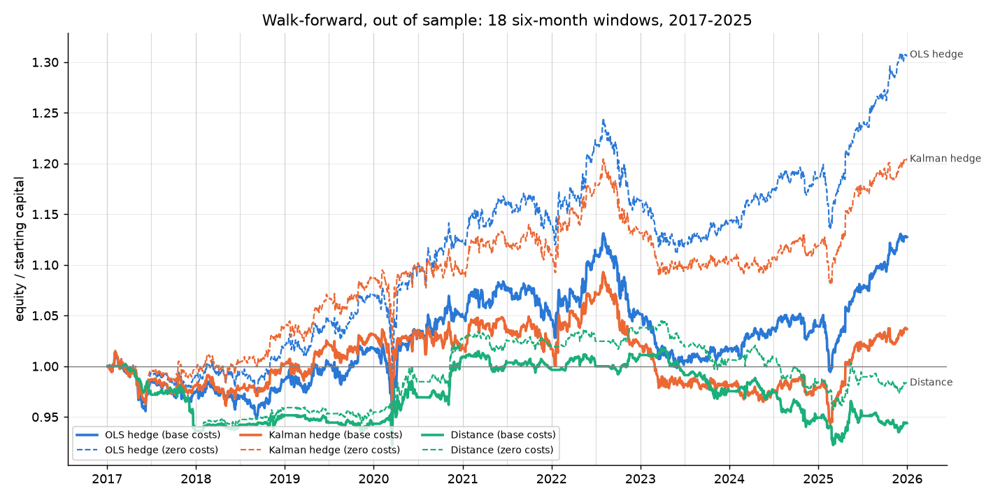
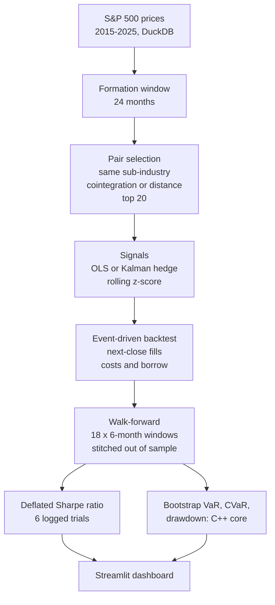

# PairsLab

[](https://github.com/noe2971/pairslab/actions/workflows/ci.yml)

[](LICENSE)

**A walk-forward pairs-trading research platform (Python + C++17) that measures how much of a backtest edge survives transaction costs, out-of-sample testing and multiple-testing correction.**

### Live dashboard: **<https://pairslab.streamlit.app>**



*Out-of-sample equity curves, 18 stitched six-month windows, 2017-2025 (base costs).*

## The problem

Pairs trading bets that two related stocks, such as two utilities, drift apart only
temporarily. You buy the cheap one, short the expensive one, and wait for the gap to close.
It is easy to make this look profitable on a backtest by picking pairs with hindsight, ignoring
costs, or trying many variants and reporting the best. PairsLab is built to avoid those
mistakes and to measure how much of a result survives.

## Method



1. **Select** pairs on 24 months of data only, within the same GICS sub-industry, two ways:
   Engle-Granger cointegration ranking and the Gatev-Goetzmann-Rouwenhorst distance method.
2. **Signal**: enter at |z| > 2, exit at |z| < 0.5, stop at |z| > 4. The hedge ratio is either a
   fixed OLS fit or a Kalman filter.
3. **Backtest** event by event. A signal at the close of day t fills at the close of day t+1.
   Costs are 5 bps per side per leg plus 0.5% a year short borrow.
4. **Walk forward**: re-select pairs every six months and trade them on the next six, never on
   data they were chosen from.
5. **Judge** with the deflated Sharpe ratio, which charges the result for the 6 strategy
   configurations tried, and a block bootstrap for tail risk. The bootstrap hot loop is in C++
   (4.5x faster than NumPy, same results to 1e-14).

Rules were written down and committed **before** results were seen, and every configuration
tried is logged in [`research/`](research/). No-look-ahead is enforced by tests that scramble
all future prices and check that earlier results do not change.

## Results (real out of sample, 2017-01-03 to 2025-12-31, 2,262 days)

Base costs. Source: [`results/walkforward.csv`](results/walkforward.csv).

| Strategy | Sharpe | CAGR | Max drawdown | Hit rate | Trades | Windows > 0 | Deflated Sharpe |
|---|---:|---:|---:|---:|---:|---:|---:|
| Cointegration, OLS hedge | **0.31** | 1.3% | 12.1% | 59.8% | 1,287 | 12 / 18 | 0.36 |
| Cointegration, Kalman hedge | 0.11 | 0.4% | 13.7% | 59.7% | 1,320 | 9 / 18 | 0.17 |
| Distance (GGR) | -0.21 | -0.6% | 9.3% | 52.4% | 269 | 7 / 18 | 0.03 |

Sharpe by cost level (zero / 5 / 10 / 20 bps per side per leg):

| Strategy | 0 bps | 5 bps (base) | 10 bps | 20 bps |
|---|---:|---:|---:|---:|
| OLS | 0.67 | 0.31 | 0.00 | -0.62 |
| Kalman | 0.50 | 0.11 | -0.22 | -0.90 |
| Distance | -0.05 | -0.21 | -0.31 | -0.51 |

What this says:

- **No variant passes the deflated Sharpe test** (a common bar is 0.95). The best Sharpe, 0.31,
  is below the 0.43 that the best of 6 worthless strategies would show by luck.
- The 95% bootstrap interval for the best Sharpe is -0.36 to 0.95, which includes zero.
- **In sample the same strategies look excellent** (mean Sharpe about 3.6 on the windows the
  pairs were chosen on, against 0.34 out of sample). That gap is the point of walking forward.
- **Costs decide it.** The OLS variant trades about 29x its capital a year; a 10 bps cost
  erases the edge.
- 1-day 99% CVaR for the OLS variant is 0.99% of equity; the real 10-day 99% CVaR (3.16%) is
  larger than the automatic-block bootstrap interval, so read tails from the 40-day-block
  numbers in [`results/risk_tail_alt_block.csv`](results/risk_tail_alt_block.csv).

A full write-up is in [`docs/writeup.md`](docs/writeup.md).

## Limitations

These all bias the results, and the first three flatter the strategy.

- **Survivorship bias.** The universe is today's S&P 500. Firms that failed or were acquired
  between 2015 and 2025 are missing, and for pairs trading those are exactly the pairs that
  diverge and never return. The results are an upper bound.
- **Full-sample missing-data filter.** Tickers with more than 5% missing days over the whole
  2015-2025 sample are dropped, so a stock must have traded for almost all of it to be eligible
  in any window. That uses future knowledge when building the universe. It also removes recent
  IPOs.
- **Today's GICS labels.** Pairs are formed within today's sub-industries, even for windows
  years earlier (for example, GICS moved GOOGL and META into Communication Services in 2018).
- **Cost assumptions.** 5 bps per side per leg, 0.5% a year borrow, fills at the next close,
  no market impact, no interest on cash. Reasonable for liquid S&P 500 names and modest size;
  not tested at scale. Sensitivity at 0, 10 and 20 bps is reported and never used to choose
  anything.
- **Trial count.** The deflated Sharpe uses N = 6, which only counts logged configurations.
  Thresholds fixed by reasoning (entry 2, exit 0.5, 20 pairs) are not counted, so N may be
  too small.
- **Kalman variant** trades the filter's forecast error while holding the entry hedge ratio
  (a locked rule, documented in PROGRESS.md).

## What's next

1. **Data v2: a point-in-time universe.** Historical S&P 500 membership and GICS labels at each
   date, and no global missing-data filter (per-window completeness only). Rerun trials 4 and 5
   unchanged on it. This is the test that matters most, because it fixes survivorship bias,
   the full-sample filter and today's-labels look-ahead together.
2. Kalman variant that trades the spread of the position actually held.
3. Cost-aware entry (wider band or minimum expected profit) to cut turnover, and distance trades
   allowed past the window end. Each is a new trial and raises N.
4. Fresh data (2026 onwards) as a true holdout.

## Run it

```bash
git clone https://github.com/noe2971/pairslab && cd pairslab
uv sync                                          # builds the C++ extension (needs CMake and a C++17 compiler)
uv run ruff check . && uv run pytest             # 283 tests
uv run streamlit run app/streamlit_app.py        # dashboard on committed results, no data download needed
```

To rebuild everything from raw data:

```bash
uv run python -m pairslab.data download          # S&P 500 prices into DuckDB
uv run python -m pairslab.walkforward --jobs 12  # 18 windows, about 80 s
uv run python -m pairslab.risk --backend cpp     # bootstrap risk
uv run python -m pairslab.app_export             # refresh files used by the dashboard
```

## Repository map

| Path | What |
|---|---|
| `src/pairslab/` | data, selection, signals, backtest engine, walk-forward, risk, trials log |
| `cpp/` | C++17 bootstrap core (pybind11) |
| `app/` | Streamlit dashboard |
| `results/` | every number quoted above, as CSV and PNG |
| `research/` | append-only logs of every configuration tried |
| `PROGRESS.md` | session-by-session decisions, audits and open questions |

## Module details

Per-stage notes on data, selection, backtest, walk-forward, risk and the dashboard are in
[`PROGRESS.md`](PROGRESS.md) (sessions 2 to 12).

Licensed under the [MIT License](LICENSE).
